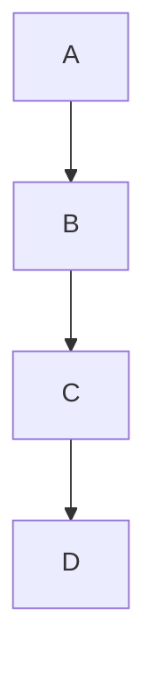
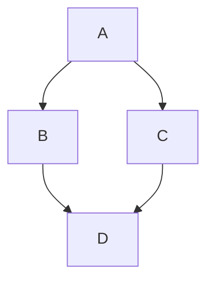
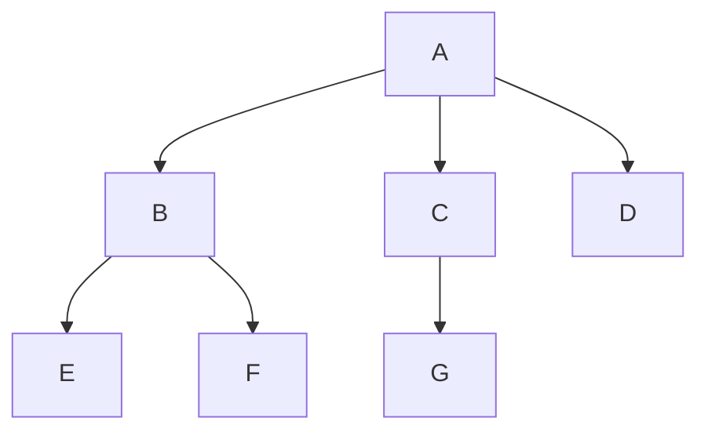
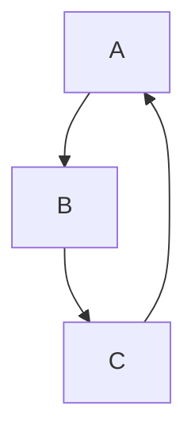
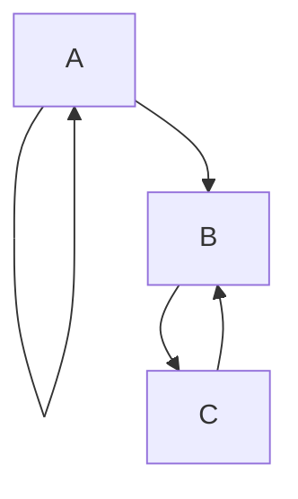
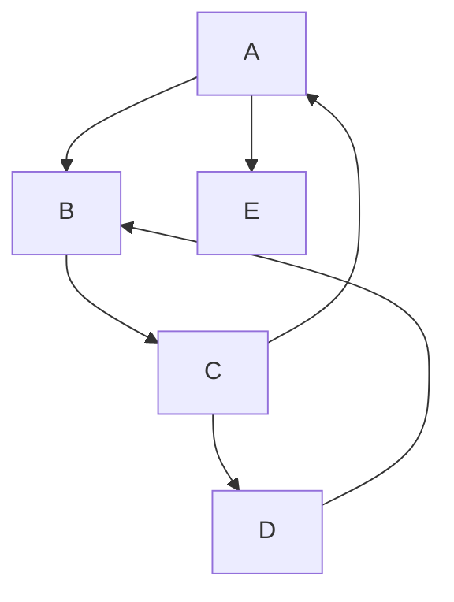
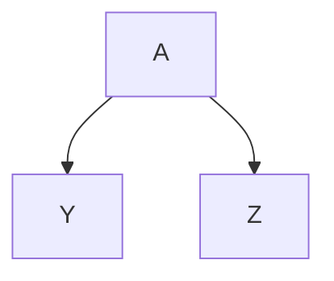
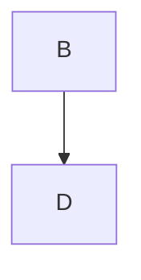
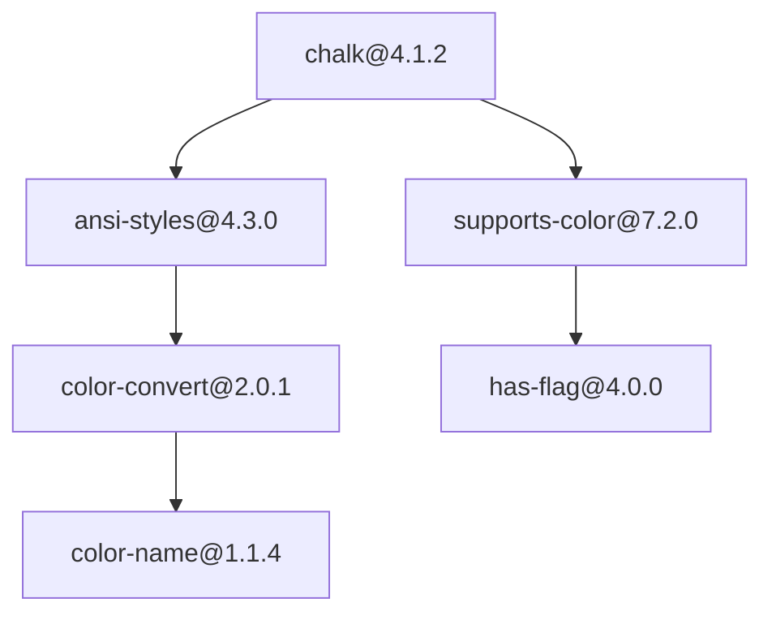
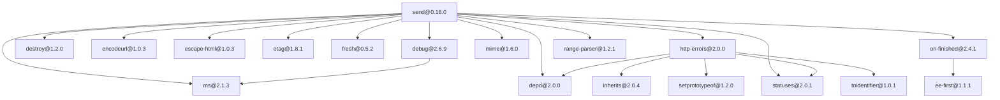

# depgraph — визуализатор графа зависимостей npm-пакетов

Практическая работа №2 по дисциплине «Конфигурационное управление», вариант №10.

## Общее описание

`depgraph` — CLI-приложение на Rust, которое строит граф зависимостей пакетов
менеджера npm. Готовые менеджеры пакетов и библиотеки для получения зависимостей
не используются.

Текущее состояние — **этап 5: визуализация** (все этапы выполнены). Приложение
читает параметры из YAML-файла (этап 1), получает из репозитория npm сведения о
пакетах (этап 2), строит полный граф зависимостей пакета с учётом транзитивности
(этап 3), умеет выводить обратные зависимости заданного пакета (этап 4) и
показывает граф в виде текста на языке Mermaid с сохранением изображения PNG
(этап 5).

Сторонние библиотеки используются только как вспомогательные инструменты и не
получают информацию о зависимостях:

| Библиотека   | Для чего                                              |
|--------------|-------------------------------------------------------|
| `serde_yaml` | чтение конфигурационного файла                        |
| `ureq`       | HTTP-запросы: к репозиторию npm и к сервису отрисовки |
| `serde_json` | разбор и формирование JSON                            |
| `flate2`, `base64` | сжатие и кодирование схемы для адреса запроса к сервису отрисовки |

Какие поля считать зависимостями, как выбрать версию по диапазону и как обойти
граф, решает код проекта (`src/npm.rs`, `src/semver.rs`, `src/graph.rs`).

## Структура проекта

```
.
├── Cargo.toml          — описание проекта и зависимостей
├── Cargo.lock          — зафиксированные версии зависимостей
├── config.yaml         — конфигурация по умолчанию
├── run.sh              — скрипт сборки и запуска
├── src/
│   ├── main.rs         — точка входа: запуск и вывод ошибок
│   ├── lib.rs          — список модулей
│   ├── cli.rs          — разбор аргументов командной строки
│   ├── config.rs       — структура конфигурации, чтение YAML, вывод
│   ├── validate.rs     — проверка значений параметров
│   ├── npm.rs          — загрузка метаданных из репозитория npm, разбор JSON
│   ├── semver.rs       — выбор версии по диапазону (^, ~, >=, x, ||, ...)
│   ├── graph.rs        — граф зависимостей, обход в ширину (BFS), вывод
│   ├── reverse.rs      — обратные зависимости пакета (BFS по обратным рёбрам)
│   ├── mermaid.rs      — текстовое представление графа на языке Mermaid
│   ├── render.rs       — преобразование Mermaid в PNG (сервис mermaid.ink)
│   ├── test_repo.rs    — тестовый репозиторий из текстового файла
│   ├── source.rs       — выбор источника данных по конфигурации
│   └── error.rs        — типы ошибок
└── tests/
    ├── cli_tests.rs        — запуск собранного приложения целиком
    ├── config_tests.rs     — чтение конфигов и разбор аргументов
    ├── npm_tests.rs        — адрес документа, разбор JSON
    ├── fetch_tests.rs      — загрузка с локальным HTTP-сервером (без интернета)
    ├── semver_tests.rs     — выбор версии по диапазону
    ├── graph_tests.rs      — BFS, циклы, длинные цепочки, вывод графа
    ├── reverse_tests.rs    — обратные зависимости: уровни, циклы, ошибки
    ├── mermaid_tests.rs    — текст Mermaid
    ├── render_tests.rs     — кодирование схемы, обмен с локальным сервисом
    ├── report_tests.rs     — итоговая работа: вывод текста и сохранение PNG
    ├── common/             — общие помощники тестов (локальный HTTP-сервер)
    ├── test_repo_tests.rs  — чтение файлов тестового репозитория
    ├── validate_tests.rs   — проверки отдельных параметров
    └── fixtures/
        ├── *.yaml          — примеры корректных и ошибочных конфигов
        └── repos/          — файлы тестовых репозиториев (графы из букв)
```

## Функции и настройки

### Запуск

```
depgraph [ПУТЬ_К_КОНФИГУ]
```

| Аргумент          | Описание                                             |
|-------------------|------------------------------------------------------|
| `ПУТЬ_К_КОНФИГУ`  | путь к YAML-файлу; по умолчанию `config.yaml`        |
| `-h`, `--help`    | показать справку                                     |

### Параметры конфигурационного файла

Все параметры обязательны, кроме `reverse_for`. Неизвестные параметры (например, с опечаткой в имени)
считаются ошибкой.

| Параметр       | Тип    | Описание                                                    | Проверки |
|----------------|--------|-------------------------------------------------------------|----------|
| `package_name` | строка | имя анализируемого пакета                                   | не пустое; обычный режим — правила npm (нижний регистр, символы `a-z 0-9 - . _ ~`, не начинается с `.`/`_`, не длиннее 214 символов, допускается `@scope/name`); тестовый режим — только большие латинские буквы |
| `repository`   | строка | URL-адрес репозитория или путь к файлу тестового репозитория | не пустое; обычный режим — URL со схемой `http://`/`https://` и хостом; тестовый режим — существующий файл |
| `test_mode`    | bool   | режим работы с тестовым репозиторием                        | `true` или `false` |
| `version`      | строка | версия пакета                                               | формат SemVer: `MAJOR.MINOR.PATCH[-pre][+build]`, без ведущих нулей |
| `output_file`  | строка | имя PNG-файла, в который сохраняется изображение графа      | не пустое; расширение `.png`; не каталог; каталог, где лежит файл, существует |
| `reverse_for`  | строка | пакет, для которого вывести обратные зависимости (**необязательный**) | если задан — те же правила, что у `package_name` |

Относительные пути считаются от текущего рабочего каталога.

Версию лучше писать в кавычках (`version: "1.0.0"`): без кавычек YAML может
прочитать значение вроде `1.0` как число, и приложение сообщит о неверном типе.

Пример (`config.yaml`):

```yaml
package_name: express
repository: https://registry.npmjs.org
test_mode: false
version: "4.18.2"
output_file: graph.png
```

### Построение графа зависимостей

Используется формат пакетов JavaScript (npm). Вершина графа — пакет, ребро
`A -> B` означает «A напрямую зависит от B». Граф строится алгоритмом **BFS без
рекурсии**: корневой пакет кладётся в очередь, затем из очереди берётся пакет,
у него запрашиваются прямые зависимости, и ещё не встречавшиеся зависимости
добавляются в конец очереди. Пакеты выводятся в порядке обхода (сначала корень,
затем его зависимости, затем зависимости зависимостей и т. д.); зависимости
пакета выводятся по алфавиту.

**Циклические зависимости.** Каждый пакет заносится в множество посещённых
при первой встрече и повторно в очередь не попадает. Поэтому цикл
`A -> B -> C -> A` не приводит к бесконечному обходу: ребро `C -> A` попадает в
граф, но `A` заново не обрабатывается. Зависимость пакета от самого себя
(`A -> A`) обрабатывается так же.

**Репозиторий npm** (`test_mode: false`). По адресу `<repository>/<имя пакета>`
репозиторий отдаёт JSON со всеми версиями пакета и их полем `dependencies`.
Для корневого пакета берётся версия из `version`. У остальных пакетов в
`dependencies` записаны не версии, а диапазоны (`^1.2.3`, `~1.3.8`, `>=2 <3`),
поэтому приложение само выбирает самую новую версию, подходящую под диапазон
(`src/semver.rs`). Поддерживаются диапазоны `^`, `~`, `>`, `>=`, `<`, `<=`, `=`,
`x`/`*`, дефисные (`1.0.0 - 2.0.0`), несколько через `||`, метки (`latest`).
Учитывается только поле `dependencies`; `devDependencies`, `peerDependencies`
и `optionalDependencies` не берутся.

Ограничения:
- вершина — это имя пакета; если разные пакеты требуют разные версии одного
  пакета, в графе будет одна версия — выбранная при первой встрече (npm в
  таких случаях ставит несколько копий);
- предварительные версии (`1.0.0-beta.1`) выбираются только при точном указании;
- диапазоны, не относящиеся к версиям (адреса git, пути `file:`, `npm:`-алиасы),
  не поддерживаются — приложение сообщает об ошибке.

**Тестовый репозиторий** (`test_mode: true`). Вместо URL в `repository` указывается
путь к текстовому файлу, описывающему граф. Пакеты называются большими
латинскими буквами. Формат — одна строка на пакет:

```
# комментарий
A: B C
B: C
C:
```

Слева от двоеточия пакет, справа его прямые зависимости через пробел. Пустые
строки и комментарии (`#`) пропускаются. Пакет, упомянутый только как
зависимость, считается пакетом без зависимостей. Версий в тестовом репозитории
нет, поэтому `version` игнорируется (но по-прежнему проверяется), а в выводе
пакеты указываются без версии. `package_name` — корневой пакет, от которого
строится граф.

### Обратные зависимости

Если задан параметр `reverse_for`, вместо графа выводятся **обратные
зависимости** этого пакета — пакеты, которые зависят от него. Граф при этом
строится так же, как на этапе 3, от пакета `package_name`, а обратные
зависимости ищутся среди пакетов этого графа. Пакет из `reverse_for` должен
входить в граф, иначе приложение сообщает об ошибке.

Зависимости ищутся транзитивно: если `A -> B -> C`, то для `C` это `B`
(зависит напрямую) и `A` (зависит через `B`). Используется тот же обход в
ширину без рекурсии, что и на этапе 3, но по перевёрнутым рёбрам графа.
Результат разбит на уровни: на уровне 1 пакеты, которые зависят от заданного
напрямую, на уровне 2 — пакеты, которые зависят от пакетов уровня 1, и т. д.
Внутри уровня пакеты идут по алфавиту.

Каждый пакет выводится один раз, циклы не зацикливают обход. Сам заданный
пакет в результат не входит, даже если он лежит на цикле. Если от пакета никто
не зависит (например, это корень графа), выводится соответствующее сообщение.

Реестр npm не умеет искать пакеты, зависящие от данного, поэтому в режиме
реального репозитория обратные зависимости определяются только в пределах
графа пакета `package_name`.

### Визуализация (Mermaid и PNG)

В обычном режиме (без `reverse_for`) приложение:

1. формирует текстовое представление графа на языке диаграмм **Mermaid**
   (`src/mermaid.rs`) и выводит его на экран;
2. превращает этот текст в изображение и сохраняет его в файл **PNG** с именем
   из `output_file` (`src/render.rs`).

Формат текста — схема `graph TD` (сверху вниз): сначала вершины, затем рёбра.
Идентификаторы Mermaid не могут содержать `@`, `/`, `.` из имён npm-пакетов,
поэтому вершины названы `n0`, `n1`, ..., а имя пакета и версия записаны в
подписи: `n0["express@4.18.2"]`. Ребро `n0 --> n1` значит «`n0` зависит от
`n1`». Цикл превращается в обычное ребро назад (`n2 --> n0`), зависимость от
самого себя — в петлю (`n0 --> n0`). Вершины идут в порядке обхода в ширину.

Рисовать Mermaid умеет только он сам (JavaScript и браузер), поэтому PNG делает
внешний сервис **[mermaid.ink](https://mermaid.ink)**: схема сжимается, кодируется
в base64 и передаётся в адресе запроса, в ответ приходит PNG. Из-за этого:

- для отрисовки нужен интернет, а текст графа уходит на публичный сервис
  (в нём только названия и версии пакетов);
- если сервис недоступен, Mermaid-текст всё равно уже выведен на экран, а
  приложение завершается с ошибкой; текст можно вставить на
  [mermaid.live](https://mermaid.live) и сохранить картинку вручную;
- адрес сервиса можно заменить переменной окружения `DEPGRAPH_RENDER_URL`
  (например, на свой сервер или заглушку в тестах).

Отрисовка спрятана за трейтом `Renderer`, поэтому сервис можно заменить другим
способом (например, локальным `mermaid-cli`), не меняя остальной код.

Файлы PNG генерируются при запуске и в репозиторий не добавляются (они в
`.gitignore`). Примеры визуализации в этом README показаны Mermaid-блоками:
GitHub рисует их сам.

### Сравнение с npm

Результат сравнивался со штатным инструментом npm — `npm ls`, который выводит
дерево зависимостей (`npm explain` показывает путь до одного пакета). Чтобы не
устанавливать пакеты, дерево строится только по метаданным:

```bash
mkdir probe && cd probe && echo '{"name":"probe","version":"1.0.0","private":true}' > package.json
npm install --package-lock-only --ignore-scripts chalk@4.1.2
npm ls --all --package-lock-only
```

Сравнивались три пакета (проверено 12.11.2026; состав графа зависит от версий,
опубликованных на момент запуска):

| Пакет | Пакетов в depgraph | Уникальных имён в npm ls | Расхождения |
|-------|-------------------:|-------------------------:|-------------|
| `chalk@4.1.2` | 6 | 6 | нет, деревья совпадают |
| `send@0.18.0` | 18 | 18 | `ms`: две версии в npm, одна в depgraph |
| `express@4.18.2` | 67 | 67 | `ms`: две версии в npm, одна в depgraph |

Состав пакетов совпадает полностью, все рёбра совпадают. Единственное
расхождение — пакет `ms`. В `npm ls` он встречается дважды: `ms@2.1.3` нужен
самому пакету (например, `send`), а `debug@2.6.9` требует `ms@2.0.0`, и npm
кладёт обе копии в разные места дерева. В графе depgraph вершина — это имя
пакета, поэтому `ms` здесь одна, с версией `2.1.3` (выбрана при первой
встрече в обходе в ширину), и стрелка от `debug` идёт к ней. Так граф
получается компактнее, но не показывает, что на самом деле установлено две
версии. Остальные различия — оформление: `npm ls` повторяет поддеревья
(помечая `deduped`), а depgraph рисует каждый пакет один раз, и `npm ls`
показывает в корне служебный проект `probe`.

Ещё одно правило, которое пришлось повторить, чтобы совпасть с npm: если у
пакета есть версия с меткой `latest` и она подходит под диапазон, npm выбирает
её, даже когда в реестре есть более новая подходящая версия. Без этого
правила у `express` появлялись три лишних пакета (`get-intrinsic@1.3.1` новее
отмеченной `latest` версии `1.3.0` и тянет за собой дополнительные
зависимости).

### Обработка ошибок

При любой ошибке приложение пишет сообщение в stderr, начинающееся с `Ошибка:`,
и завершается с кодом 1. Ошибки бывают семи видов:

1. **Аргументы командной строки** — лишний аргумент или неизвестный флаг.
2. **Чтение файла** — файл не найден или нет прав на чтение.
3. **Структура файла** — некорректный YAML, пустой файл, нет обязательного
   параметра, неизвестный параметр, неверный тип значения.
4. **Значения параметров** — проверяются все параметры, и все найденные
   ошибки выводятся сразу одним списком.
5. **Получение данных** — в сообщении указан пакет, на котором произошла ошибка:
   - репозиторий недоступен, пакет не найден (HTTP 404), другой код ошибки;
   - ответ не является корректным документом пакета;
   - нет версии, подходящей под диапазон, или диапазон не поддерживается;
   - файл тестового репозитория не прочитан или содержит ошибку (указан
     номер строки), корневого пакета нет в тестовом репозитории.
6. **Обратные зависимости** — пакет из `reverse_for` не входит в граф.
7. **Изображение** — сервис отрисовки недоступен, вернул ошибку (например, 503)
   или не PNG, файл `output_file` не удалось записать. Mermaid-текст к этому
   моменту уже выведен.

## Сборка и тесты

Нужен установленный Rust (`cargo`).

```bash
cargo build --release
```

```bash
cargo test
```

Тесты не требуют интернета: и репозиторий npm, и сервис отрисовки заменяются
локальным HTTP-сервером, который поднимается внутри теста.

Запуск через скрипт (собирает и запускает). Для отрисовки PNG всегда нужен
интернет (сервис mermaid.ink), а для реального репозитория — ещё и доступ к npm.
Режим обратных зависимостей (`reverse_for`) картинку не рисует:

```bash
./run.sh tests/fixtures/test_cycle.yaml
```

```bash
./run.sh
```

## Примеры использования

### Тестовый репозиторий (`test_mode: true`)

Файлы описаний лежат в `tests/fixtures/repos`, конфиги к ним — в
`tests/fixtures/test_*.yaml`. В выводе сначала идёт Mermaid-текст, затем
строка о сохранении PNG. Ниже вывод показан один раз, для ромба `diamond.txt`
(`A: B C`, `B: D`, `C: D`, `D:`):

```
$ ./run.sh tests/fixtures/test_diamond.yaml
graph TD
    n0["A"]
    n1["B"]
    n2["C"]
    n3["D"]
    n0 --> n1
    n0 --> n2
    n1 --> n3
    n2 --> n3
Изображение графа сохранено в файле graph.png
```

Для остальных случаев показана только схема (GitHub рисует Mermaid-блоки).

Цепочка `A -> B -> C -> D` (`test_chain.yaml`):



Ромб: общая зависимость `D` входит в граф один раз (`test_diamond.yaml`):



Дерево: порядок вершин показывает обход в ширину (`test_tree.yaml`):



Цикл `A -> B -> C -> A` (`test_cycle.yaml`):



Пакет зависит от самого себя, а `B` и `C` зависят друг от друга
(`test_self_cycle.yaml`):



Два цикла с общим пакетом (`test_two_cycles.yaml`):



Пакеты, упомянутые только как зависимости (`test_undeclared.yaml`):



Граф от другого пакета, не от `A` (`test_from_b.yaml`, ромб, корень `B`):



Ошибки тестового режима:

```
$ ./run.sh tests/fixtures/test_missing_root.yaml
Ошибка: не удалось получить зависимости: пакет 'Q': пакет не найден в тестовом репозитории

$ ./run.sh tests/fixtures/test_bad_syntax.yaml
Ошибка: не удалось получить зависимости: файл 'tests/fixtures/repos/bad_syntax.txt': строка 2: ожидалась запись вида 'A: B C', получено 'это не запись пакета'
```

Сервис отрисовки недоступен (для проверки адрес заменён на неработающий).
Mermaid-текст уже выведен, затем ошибка:

```
$ DEPGRAPH_RENDER_URL=http://127.0.0.1:1 ./run.sh tests/fixtures/test_chain.yaml
graph TD
    ...
Ошибка: не удалось создать изображение: сервис отрисовки недоступен: io: Connection refused (os error 111)
```

### Обратные зависимости (`reverse_for`)

Конфиги лежат в `tests/fixtures/reverse_*.yaml`. Основной пример — файл
`reverse_demo.txt`, где до пакета `G` ведёт несколько путей:

```
A: B C
B: D E
C: E F
D: G
E: G
F:
G:
```

Обратные зависимости пакета `G` (`reverse_demo_g.yaml`):

```
$ ./run.sh tests/fixtures/reverse_demo_g.yaml
Обратные зависимости G в графе A: 5
  уровень 1 (напрямую): D, E
  уровень 2 (через другие пакеты): B, C
  уровень 3 (через другие пакеты): A
```

Пакет `E`, до которого ведут два пути (`reverse_demo_e.yaml`):

```
$ ./run.sh tests/fixtures/reverse_demo_e.yaml
Обратные зависимости E в графе A: 3
  уровень 1 (напрямую): B, C
  уровень 2 (через другие пакеты): A
```

Пакет `F` в другой ветке (`reverse_demo_leaf_f.yaml`):

```
$ ./run.sh tests/fixtures/reverse_demo_leaf_f.yaml
Обратные зависимости F в графе A: 2
  уровень 1 (напрямую): C
  уровень 2 (через другие пакеты): A
```

Цепочка `A -> B -> C -> D`, пакет `D` (`reverse_chain_d.yaml`):

```
$ ./run.sh tests/fixtures/reverse_chain_d.yaml
Обратные зависимости D в графе A: 3
  уровень 1 (напрямую): C
  уровень 2 (через другие пакеты): B
  уровень 3 (через другие пакеты): A
```

Ромб, пакет `D` (`reverse_diamond_d.yaml`):

```
$ ./run.sh tests/fixtures/reverse_diamond_d.yaml
Обратные зависимости D в графе A: 3
  уровень 1 (напрямую): B, C
  уровень 2 (через другие пакеты): A
```

Корень графа: от него никто не зависит (`reverse_demo_root.yaml`):

```
$ ./run.sh tests/fixtures/reverse_demo_root.yaml
Обратные зависимости A в графе A: 0
  (ни один пакет графа не зависит от этого пакета)
```

Цикл `A -> B -> C -> A`. Для `A` зависимости — `C` и `B`; сам `A` не входит
в результат (`reverse_cycle_a.yaml`, `reverse_cycle_c.yaml`):

```
$ ./run.sh tests/fixtures/reverse_cycle_a.yaml
Обратные зависимости A в графе A: 2
  уровень 1 (напрямую): C
  уровень 2 (через другие пакеты): B

$ ./run.sh tests/fixtures/reverse_cycle_c.yaml
Обратные зависимости C в графе A: 2
  уровень 1 (напрямую): B
  уровень 2 (через другие пакеты): A
```

Два цикла с общим пакетом (`reverse_two_cycles_d.yaml`):

```
$ ./run.sh tests/fixtures/reverse_two_cycles_d.yaml
Обратные зависимости D в графе A: 3
  уровень 1 (напрямую): C
  уровень 2 (через другие пакеты): B
  уровень 3 (через другие пакеты): A
```

Ошибки:

```
$ ./run.sh tests/fixtures/reverse_not_in_graph.yaml
Ошибка: не удалось найти обратные зависимости: пакет 'Z' не входит в граф зависимостей

$ ./run.sh tests/fixtures/reverse_bad_name.yaml
Ошибка: недопустимые значения параметров:
  - reverse_for: в тестовом режиме имя пакета должно состоять из больших латинских букв (например, A или ABC), получено 'g1'
```

Реальный репозиторий: какие пакеты графа `express` зависят от `depd`
(`reverse_npm.yaml`, нужен интернет):

```
$ ./run.sh tests/fixtures/reverse_npm.yaml
Обратные зависимости depd в графе express@4.18.2: 6
  уровень 1 (напрямую): body-parser, express, http-errors, send
  уровень 2 (через другие пакеты): raw-body, serve-static
```

### Реальный репозиторий npm: три пакета

Три пакета разного размера (результаты сравнения с `npm ls` — в разделе
«Сравнение с npm»).

**`chalk@4.1.2`** — 6 пакетов:



**`send@0.18.0`** — 18 пакетов. `ms` в графе одна (с версией `2.1.3`), хотя
`debug@2.6.9` требует `ms@2.0.0` (см. «Сравнение с npm»):



**`express@4.18.2`** (`config.yaml`) — 67 пакетов и 125 зависимостей, схема
слишком длинная для README. Запуск:

```
$ ./run.sh
graph TD
    n0["express@4.18.2"]
    n1["accepts@1.3.8"]
    n2["array-flatten@1.1.1"]
    ...
Изображение графа сохранено в файле graph.png
```

Конфиги для демонстрации: `config.yaml` (express), `tests/fixtures/scoped.yaml`
(пакет с областью `@babel/core`) и `tests/fixtures/no_deps.yaml` (пакет без
зависимостей `is-number`, схема из одной вершины).

### Ошибки получения данных

Пакета нет в репозитории:

```
$ ./run.sh tests/fixtures/not_found_package.yaml
Ошибка: не удалось получить зависимости: пакет 'this-package-does-not-exist-xyz-12345': пакет не найден в репозитории (https://registry.npmjs.org/this-package-does-not-exist-xyz-12345)
```

Нет такой версии:

```
$ ./run.sh tests/fixtures/not_found_version.yaml
Ошибка: не удалось получить зависимости: пакет 'express': нет версии, подходящей под '999.0.0'
```

Репозиторий недоступен:

```
$ ./run.sh tests/fixtures/unreachable.yaml
Ошибка: не удалось получить зависимости: пакет 'express': не удалось подключиться к http://127.0.0.1:1/express: io: Connection refused (os error 111)
```

### Демонстрация обработки ошибок

Файл не найден:

```
$ ./run.sh tests/fixtures/no_such.yaml
Ошибка: не удалось прочитать файл 'tests/fixtures/no_such.yaml': No such file or directory (os error 2)
```

Синтаксическая ошибка YAML:

```
$ ./run.sh tests/fixtures/invalid_yaml.yaml
Ошибка: некорректный конфигурационный файл 'tests/fixtures/invalid_yaml.yaml': found unexpected end of stream at line 4 column 1, while scanning a quoted scalar at line 2 column 15
```

Пустой файл:

```
$ ./run.sh tests/fixtures/empty.yaml
Ошибка: некорректный конфигурационный файл 'tests/fixtures/empty.yaml': missing field `package_name`
```

Нет обязательного параметра:

```
$ ./run.sh tests/fixtures/missing_field.yaml
Ошибка: некорректный конфигурационный файл 'tests/fixtures/missing_field.yaml': missing field `version` at line 2 column 1
```

Опечатка в имени параметра:

```
$ ./run.sh tests/fixtures/unknown_field.yaml
Ошибка: некорректный конфигурационный файл 'tests/fixtures/unknown_field.yaml': unknown field `packge_name`, expected one of `package_name`, `repository`, `test_mode`, `version`, `output_file` at line 2 column 1
```

Неверный тип значения:

```
$ ./run.sh tests/fixtures/wrong_type.yaml
Ошибка: некорректный конфигурационный файл 'tests/fixtures/wrong_type.yaml': test_mode: invalid type: string "да", expected a boolean at line 4 column 12
```

Недопустимые значения всех параметров (обычный режим):

```
$ ./run.sh tests/fixtures/bad_values.yaml
Ошибка: недопустимые значения параметров:
  - package_name: имя npm-пакета должно быть в нижнем регистре: 'Express'
  - repository: URL должен начинаться с http:// или https://, получено 'registry.npmjs.org' (для файла тестового репозитория укажите test_mode: true)
  - version: версия должна иметь вид MAJOR.MINOR.PATCH (версия '4.18')
  - output_file: файл должен иметь расширение .png: 'graph.jpg'
```

Недопустимые значения всех параметров (тестовый режим):

```
$ ./run.sh tests/fixtures/bad_test_mode.yaml
Ошибка: недопустимые значения параметров:
  - package_name: в тестовом режиме имя пакета должно состоять из больших латинских букв (например, A или ABC), получено 'a1'
  - repository: файл тестового репозитория не найден: 'tests/fixtures/no_such_file.txt'
  - version: некорректная pre-release-часть версии: ''
  - output_file: каталог для выходного файла не существует: 'no_such_dir'
```

Неверные аргументы:

```
$ ./run.sh a.yaml b.yaml
Ошибка: лишний аргумент: 'b.yaml'

Использование: depgraph [ПУТЬ_К_КОНФИГУ]
...
```
